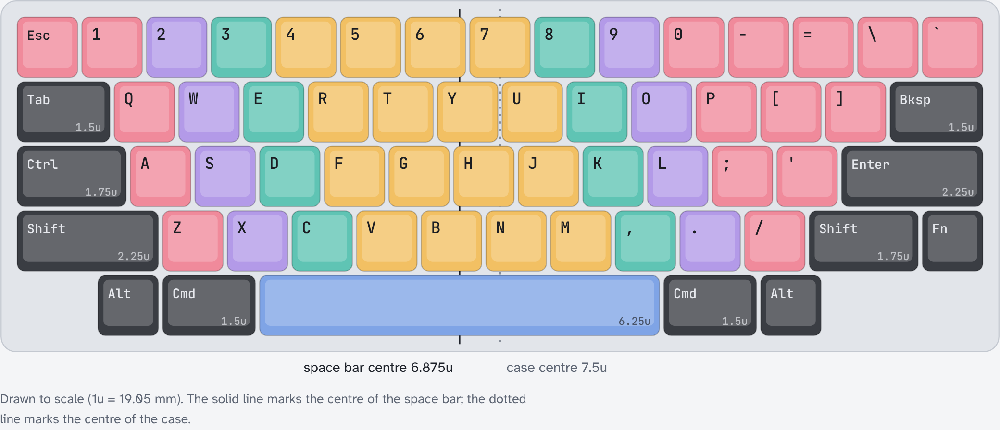

# Polymetis

A 60-key, low-profile keyboard in the exact HHKB Professional 2 layout, with a one-piece 6.25u space bar, Gateron KS-33 low-profile switches on hot-swap sockets, an RP2040 on the board, and RMK firmware with Vial.

The layout is drawn to scale in [`docs/layout.html`](docs/layout.html): keys are coloured by the finger that presses them, and the modifiers are dark grey to match the body. A rotatable concept model is in [`docs/concept.html`](docs/concept.html).

## At a glance

| | |
|---|---|
| Keys | 60, HHKB Professional 2 |
| Bottom row | 1.25u gap, Alt, Cmd 1.5u, Space 6.25u, Cmd 1.5u, Alt, 2.5u gap |
| Switches | Gateron KS-33 Low Profile 2.0, linear (Red) |
| Sockets | Gateron KS-2P02B01-02 hot-swap |
| Stabilisers | one Gateron low-profile plate-mounted 6.25U under the space bar |
| Controller | RP2040 on the board, USB-C |
| Top plate | 1.2 mm FR4, 14.00 mm switch cut-outs |
| Bottom plate | 1.6 mm FR4 with a notch for the USB-C receptacle |
| Frame | 5.3 mm, printed |
| Firmware | RMK with Vial; base layer and the HHKB Fn layer, plus track controls |

The HHKB Professional 2 bottom row has a 6u space bar and a 1.5u gap on the left. Polymetis uses a 6.25u space bar, which low-profile keycap sets include, and takes the extra 0.25u from the left gap. The right-hand bottom keys sit clear of the RP2040, reset pad and boot button. The space bar is centred 6.875u from the left edge, which is where the boundary between the two index fingers falls when averaged over the three letter rows.

## Parts

| Part | Quantity | Notes |
|---|---|---|
| Gateron KS-33 Low Profile 2.0 switch, linear (Red) | 60 | 3.0 mm total travel, 1.7 mm to actuation, 50 gf (Gateron drawing); chosen for short travel |
| Gateron KS-2P02B01-02 low-profile hot-swap socket | 60 | JLCPCB lists it as C18212911; zero stock in October 2026, so plan to solder them by hand |
| Gateron low-profile plate-mounted stabiliser, 6.25U (KS-57B623T) | 1 | sold in a 60% set with four 2U; only the 6.25U is used |
| Main PCB, 1.6 mm, with JLCPCB assembly | 1 | files in `jlcpcb/` |
| Top plate, 1.2 mm FR4 | 1 | `top-plate/` |
| Bottom plate, 1.6 mm FR4 | 1 | `bottom-plate/` |
| Printed middle frame, 5.3 mm | 1 | `case/polymetis-frame.stl` |
| Rubber feet | 4 | tall enough for your USB-C plug: half the plug's thickness minus 2 mm (see `docs/checks/pre-order-verification.md`) |
| M2 screws and nuts | 8 | through top plate, frame and bottom plate (8.1 mm stack) |
| Low-profile keycaps with a cross (MX) stem | 60 | 51 × 1u, 4 × 1.5u, 2 × 1.75u, 2 × 2.25u, 1 × 6.25u |

When ordering FR4 plates from JLCPCB, pay the small extra to leave the order number off.

Gateron's datasheets for the switch, socket and stabilisers are in [`docs/datasheets/`](docs/datasheets/), with a note of what each drawing confirms.

## Stack height

All figures in millimetres, from Gateron's drawings unless marked.

| Layer | Thickness | Source |
|---|---|---|
| Top plate | 1.20 | KS-33 drawing: plate 1.20 ± 0.05 |
| Gap, plate to PCB | 1.30 | KS-33 drawing: plate top to PCB top 2.50 ± 0.05 |
| PCB | 1.60 | |
| Tallest part below the PCB | 2.16 | flash U4, SOIC-8 208-mil, maximum height (Winbond W25Q16JV datasheet) |
| Clearance | 0.24 | |
| **Frame** | **5.30** | gap + PCB + tallest part + clearance |
| Bottom plate | 1.60 | |

The hot-swap sockets are 1.87 below the PCB (KS-2P02B01-02 drawing, ± 0.05) and the reset button 1.5 (XKB TS-1187A); the flash chip is the tallest at 1.95 nominal, 2.16 maximum. The exception is the USB-C receptacle (HRO TYPE-C-31-M-12), which stands 3.26 above the PCB surface it is mounted on. It sits in the frame's USB opening, and the bottom plate has a matching 16 × 13.7 mm notch below it. The stabiliser housing reaches 0.35 below the PCB through its slots.

The frame cavity is cut from the PCB outline plus 0.3 mm.

## The space bar stabiliser

The Gateron 6.25U stabiliser housings reach 3.25 mm below the top plate, more than the 1.30 mm gap, so the PCB has a slot under each housing. Gateron does not publish PCB slot dimensions. The slots here are 6.5 × 16 mm at 100 mm spacing, the size Keebio uses for this stabiliser, centred on the stems and offset 1.8 mm towards the wire-hook side. The top plate uses Gateron's recommended cut-out (6.00 × 12.50 mm housing openings with a 1.70 mm notch, and the 2.50 mm wire groove between them), measured from Gateron's drawing.

The space bar row is only 7.9 mm from the PCB's front edge, so the stabiliser is turned with its notch and wire hooks towards the back of the keyboard; the plate cut-out and the PCB slots both face that way.

**Test-fit before ordering the main PCB.** Order the top plate first (it is cheap), fit the stabiliser and a KS-33 switch, and check that the housings and wire sit within the PCB slot outline in `pcb/local.pretty/STAB_Gateron_LP_6.25U_PCB.kicad_mod`. Enter and left Shift have no stabilisers by design.

## Assembly notes

- Fit the stabiliser in the top plate with its notch towards the back of the keyboard.
- The bottom plate's "Polymetis" text faces outwards (down). The USB notch then lines up with the frame's USB opening at the back right.
- Sockets go on the underside of the PCB, the same side as the RP2040 and diodes. Switches go in from the top through the plate.

## Firmware

RMK 0.5 with Vial, in `firmware/`. Layer 0 is the HHKB Professional 2 base layer. Layer 1 replicates the HHKB Professional 2 Fn layer, plus track controls and a bootloader key on keys the HHKB leaves unused. Hold Fn (right of right Shift) and press

| Keys | Function |
|---|---|
| Esc | Power |
| `1` … `=` | F1 … F12 |
| `\` / `` ` `` | Insert / Delete |
| Tab | Caps Lock |
| `I` `O` `P` | Print Screen, Scroll Lock, Pause |
| `[` | Up |
| Backspace | Backspace |
| `A` `S` `D` | Volume down, volume up, mute |
| `F` | Eject (the HHKB's Mac-mode key) |
| `H` `J` | Keypad `*`, keypad `/` |
| `K` `L` | Home, Page Up |
| `;` `'` | Left, right |
| Enter | Keypad Enter |
| `N` `M` | Keypad `+`, keypad `-` |
| `,` `.` | End, Page Down |
| `/` | Down |
| `Z` `X` `C` | Previous track, play/pause, next track (not on the HHKB) |
| `B` | Bootloader, for flashing (not on the HHKB) |

Any key can be remapped live from the Vial app (or vial.rocks in Chrome), with no rebuild.

### Building and flashing

1. Install Rust with [rustup](https://rustup.rs) (the repo pins the toolchain) and cargo-make: `cargo install cargo-make`.
2. From `firmware/`, run `cargo make uf2`. It builds the firmware and writes `polymetis.uf2`.
3. The first time, hold the board's boot button while plugging in USB. Later, press Fn + B instead. The keyboard appears as a USB drive called RPI-RP2.
4. Copy `polymetis.uf2` onto that drive. The keyboard restarts with the new firmware.

`firmware/README.md` covers flashing with a debug probe instead.

## Design files

| Path | Contents |
|---|---|
| `pcb/` | Main PCB, KiCad 9 (`polymetis.kicad_pro`) |
| `pcb/marbastlib-xp-gateron_lp.pretty` | KS-33 footprints from marbastlib |
| `jlcpcb/` | Main PCB Gerbers, drill files, BOM and placement files for JLCPCB |
| `top-plate/`, `bottom-plate/` | Plate projects and factory files |
| `case/` | Frame: `make_frame.py` and `polymetis-frame.stl`, built from `frame-source.stl` |
| `firmware/` | RMK firmware, `keyboard.toml` and `vial.json` |
| `polymetis.json` | Keyboard Layout Editor description |
| `docs/` | Layout and concept pages, datasheets, ERC/DRC reports and renders |

## Credits

- [ebastler/marbastlib](https://github.com/ebastler/marbastlib) for the KS-33 hot-swap footprints and socket 3D model (CERN-OHL-P-2.0, licence in `pcb/marbastlib-xp-gateron_lp.pretty/LICENSE`).
- [Keebio](https://github.com/keebio/Keebio-Parts.pretty) for the Gateron low-profile stabiliser PCB slot size (MIT).
- [RMK](https://github.com/haobogu/rmk) firmware.
- Gateron for the switch, socket and stabiliser drawings.

## Licence

MIT; see [`LICENSE`](LICENSE).
